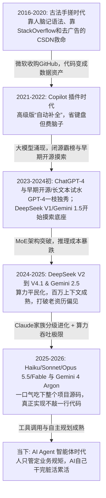
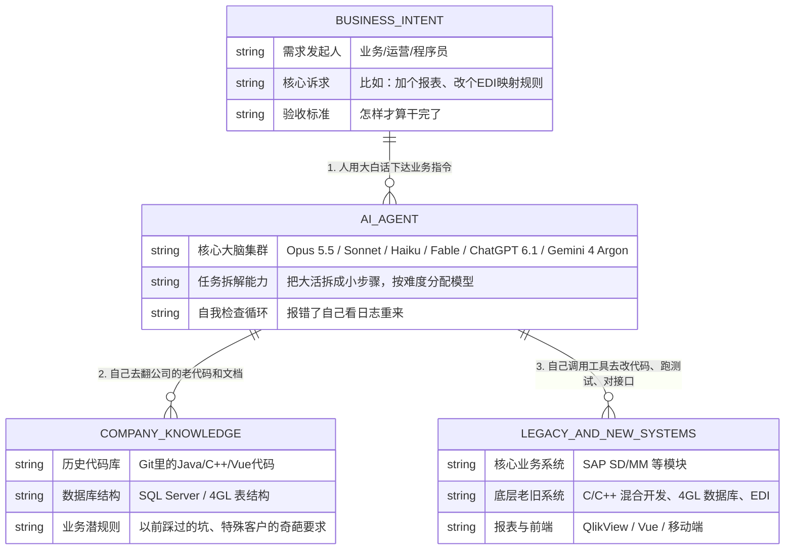

# 从“古法手搓”到“一句话生成全栈”：一个老程序员眼里的 AI 进化史

## 写在前面：我们是怎么走到今天这一步的？

我是 2016 年入行开始写代码的。那时候我们管写代码叫“手搓”——遇到不会的报错，第一反应是打开 Google 和 StackOverflow、SegmentFault、甚至是 CSDN（通常得装很多浏览器插件以此减少满屏的广告），在一堆中英文帖子里找那个打了绿勾的回答；想看别人怎么写架构，就去 GitHub 上扒源码。当年我为了赶项目，曾经硬生生用 7 天时间啃完 C 语言直接上手干活。那时候觉得，程序员的本事全在脑子里的记性、手上的熟练度，以及熬夜查 Bug 的耐力。

但这几年，一切都变了。

就在前阵子，我用最新的 ChatGPT 6.1Sol 和 Claude Opus 5.5 做了一个完整的项目：从安卓客户端、Java 后端服务，一直到前端的 Vue 界面，**我几乎没有自己亲手敲过一行代码**。我只负责把控结构、提要求、看结果。

作为一个亲历者，看着 AI 从最初那个只能帮我补全半行代码的 IDE 小插件，一步步变成今天能自己思考、自己调接口、自己改 Bug 的“智能体（Agent）”，感触非常深。借着这次汇报的机会，我想脱开那些虚头巴脑的概念，结合我这几年的实操体感，跟咱们管理层、开发兄弟还有业务同事聊聊：**这几年 AI 到底在哪几个节点真正实现了质变？它对我们现在的系统意味着什么？**

---

## 一、 AI 编程进化的几个关键“分水岭”

为了让大家看得直观，我先把我这十年的体感画了一张演进图：

下面我用大白话聊聊每个阶段的真实水平、它到底突破了什么，以及当时最让我们头疼的坑：

### 1. 微软收购 GitHub 前后（2018年以前）：纯手工业时代
- **那时候是怎么干活的**：代码是一行行敲的，逻辑是一点点抠的。那时候 GitHub 只是个存代码的网盘，大家比拼的是谁背的 API 多、谁踩的坑多。
- **历史转折点**：2018 年微软花 75 亿美金买下 GitHub。当时很多人看不懂，后来才明白，微软买下的不是一个网站，而是人类历史上最大的一座“代码矿山”。没有这笔收购，就没有后来的 Copilot。

### 2. GitHub Copilot 刚出来那会儿（2021 - 2022）：第一次觉得“键盘省力了”
- **真实体感**：这是我第一次在编辑器里装 AI 插件。你写个函数名或者写行注释，它唰一下给你补全后面十几行。对于写 repetitive（重复性）的增删改查代码特别爽。
- **突破了什么**：第一次把代码从“去网上搜”变成了“在编辑器里直接长出来”。
- **当时的痛点**：**视野太窄（上下文太短）**。它只看得到你当前打开的这一个文件，根本不知道你整个项目的架构是什么，经常一本正经地给你补全一堆编译都通不过的假代码。

### 3. ChatGPT-4 横空出世（2023）：从“补全工具”变成了“外挂大脑”
- **真实体感**：震撼。以前不会写正则、不会调冷门接口，要查半天文档；有了 GPT-4，直接把报错甩给它，它不仅给你改好，还能像老师一样给你讲明白为什么错。
- **突破了什么**：有了真正的**逻辑推理能力**和跨语言翻译能力。你可以让它把一段老掉牙的 C 代码翻译成 Java，准确率极高。
- **当时的痛点**：第一是**贵**，调 API 成本很高；第二是**记性短**，你跟它聊上几十句，它就把最开始定的规矩忘了，还是没法直接接手公司里动辄几十万行代码的老项目。

### 4. DeepSeek V2 以前与突围，直到 DeepSeek 4.1（2023末 - 2025）：从“开源玩具”到把大模型拉下神坛
- **DeepSeek V2 以前的样子（早期开源摸索期）**：在 V2 出来之前，开源界基本在跟着 Meta 的 LLaMA 屁股后面跑。那时候第一代 DeepSeek Coder 和早期 V1 刚刚探出头，虽然能写点小脚本，但采用的还是传统的稠密（Dense）架构——算力消耗大、部署成本高，写稍微绕一点的企业级逻辑就会陷入死循环。当时大家都觉得开源模型就是给极客玩的“玩具”，企业真要干活还得交高昂的保护费去用国外闭源模型。
- **V2 到 4.1 的真实体感**：转折点就是 DeepSeek V2。它靠着架构创新（MLA 多头潜在注意力和 MoE 混合专家模型），硬生生把 API 价格打到了原来的几十分之一；到了后来的 V3 乃至 4.1 版本，它的代码逻辑、数学推理和架构拆解能力已经完全不输国际顶尖闭源模型了。
- **突破了什么**：**极致的性价比与开源生态闭环**。它让企业内部部署一套属于自己的“代码大脑”不再需要天价预算。
- **当时的痛点**：模型虽然便宜又聪明了，但怎么把它跟公司内部的脏数据、老系统安全地连起来，成了新的工程难题。当然，那时候还有不少老资历的程序员固执地认为，AI 大模型顶多画画前端页面，根本无法处理后端高并发、复杂数据库或者所谓的复杂定制化业务场景。

### 5. 从 Gemini 2.5 以前到 Gemini 4 Argon：吞吐量与全局视野的暴力美学
- **Gemini 2.5 以前的样子（从 Bard 到 1.5 Pro 的爬坡期）**：谷歌最早被 ChatGPT 打了个措手不及，早期的 Bard 和 Gemini 1.0 写代码经常出现低级幻觉，甚至连依赖包的版本号都是瞎编的。到了 Gemini 1.5 Pro，谷歌第一次亮出了“百万级 Token 上下文”的底牌，虽然能一次性塞进几十个代码文件了，但那时候它像个“一目十行却抓不住重点”的学生——东西全读进去了，但在大海捞针找一个深层隐蔽 Bug 时，逻辑推理依然不够稳，改了东墙补西墙。
- **Gemini 2.5 到 Gemini 4 Argon 的质变**：到了 2.5 Pro，它的多模态与代码长文本推理终于咬合上了；而到了现在的 **Gemini 4 Argon**，它拥有极其恐怖的上下文吞吐量与精准度。你可以把整个项目的几百个文件、MS SQL Server / 4GL 数据库表结构、甚至几十页的业务 PDF 文档一股脑全塞给它，它不仅不会“迷失在中间”，还能瞬间理清跨系统的数据血缘关系。

### 6. Anthropic 家族全系进化（Haiku / Sonnet / Opus 5.5 / Fable）：真正实现“不写一行代码”
如果说谷歌拼的是吞吐量，那 Anthropic 的 Claude 系列就是程序员眼里真正的“代码艺术品”。这几年我看着它衍生出了一套极其精准的“特种部队”体系：
- **Haiku（轻骑兵）**：极致的速度与低成本。平时用来做代码实时补全、日志快速清洗、简单 SQL 转换，几乎是零延迟，指哪打哪。
- **Sonnet（绝对主力）**：从当年封神的 3.5/3.7 Sonnet 一路进化过来，它是日常全栈开发的性价比之王。80% 的日常业务代码、Vue 前端组件、Java 接口联调，它都能以极高的代码审美一次性写对。
- **Opus 到 Opus 5.5（重装统帅）**：这就是我前面说的，配合 ChatGPT 6.1Sol 帮我搞定安卓 + Java + Vue 全栈的终极杀器。面对极其复杂的系统架构重构、并发死锁排查、或者像 C/C++ 与老旧系统混合的硬骨头，Opus 5.5 在边界条件处理上的智商，已经超越了市面上绝大多数普通中高级程序员。它写出来的代码结构非常干净，自己运行报错了，看一眼日志就能自主纠错，根本不需要我动手。
- **Fable（深水区架构与推演）**：针对超长链路、跨系统异构逻辑与复杂业务故事线的深度推演模型。当系统不单单是写代码，而是需要把破碎的业务诉求、历史遗留规则（比如复杂的 EDI 报文规范）编织成严密的工程蓝图时，Fable 展现出了惊人的长程规划能力。
- **现在的难点**：走到这一步，瓶颈已经彻底不在 AI 写不写得出代码了，而在于**人能不能把业务需求说清楚**。如果你自己脑子里是一团浆糊，AI 就会以极快的速度给你生成一堆毫无业务价值的垃圾代码。

---

## 二、 给不同角色看一张图：现在的 AI Agent 到底是怎么干活的？

很多业务同事或者管理层会问：“你们老说智能体（Agent），它跟聊天框里的 AI 到底有什么区别？”

简单说，聊天框里的 AI 是个“军师”，光说不练；而 Agent 是个“包工头”，它手里有工具，能直接去数据库查表、能去读写代码库、能自己跑测试。不同的活儿它还会自动调度不同级别的模型（比如小活派给 Haiku，主干活派给 Sonnet，碰见硬骨头呼叫 Opus 5.5 或 Gemini 4 Argon）。我画了一张底层关系图（ER 逻辑），大家一看就明白现在的技术底座是怎么转的：

---

## 三、 总结：给 CIO、开发和业务的三句心里话

1. **跟 CIO 汇报**：现在的 AI 早就过了“买几个账号让大家写写周报、补全两行代码”的阶段了。从 DeepSeek 把私有化成本打下来，到 Gemini 4 Argon / Opus 5.5 具备全局系统接管能力，我们现在最大的机会，是用 AI 去**盘活和梳理公司那些没人敢动的历史技术债**，把核心业务单点依赖的风险降下来。
2. **跟开发兄弟**：别再迷恋“手搓代码”的手艺活了，也别再抱有“AI 写不了复杂后端和数据库”的旧偏见了。我当年 7 天啃下 C 语言引以为傲，但现在 AI 10 秒钟就能写出比我当年更稳的底层逻辑。以后咱们的核心价值，绝对不是谁敲代码快，而是**谁更懂公司的业务链条，谁能镇得住架构，谁能把 AI 调教得服服帖帖**。
3. **跟业务同事说**：以前你们提个需求，开发排期要半个月；以后有了 AI，画面和基础功能可能半天就出来了。但这也意味着，**业务规则本身不能再拍脑袋了**。因为 AI 是一面放大镜，业务逻辑越清晰，它交付得越快；业务要是朝令夕改，系统乱得也比以前快十倍。
